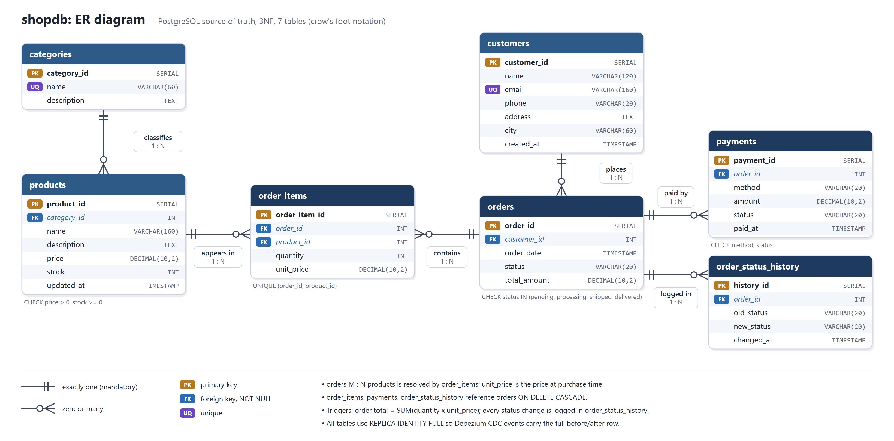
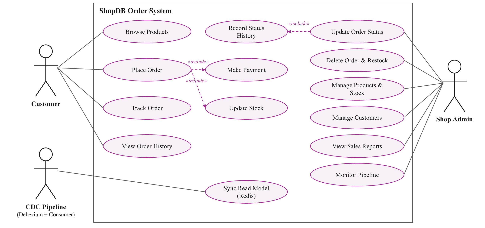
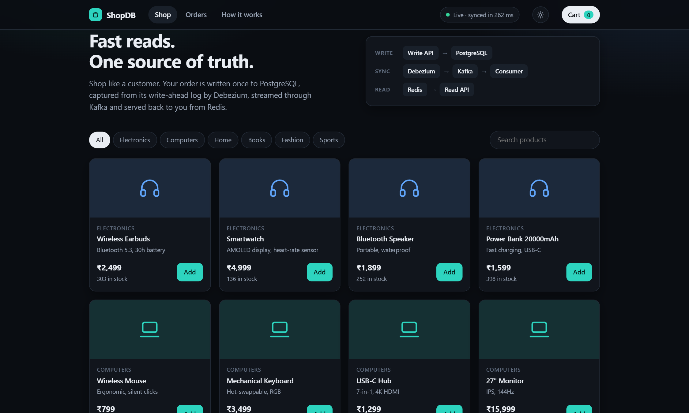
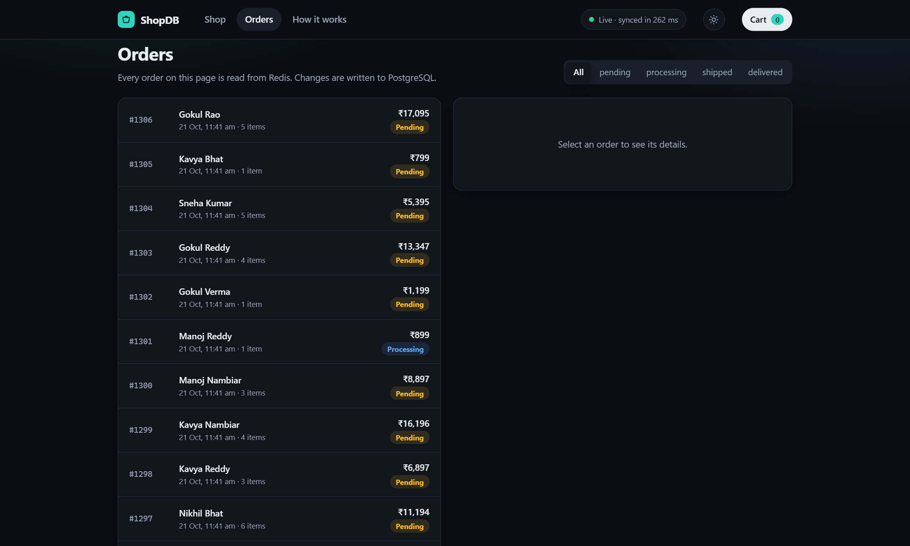
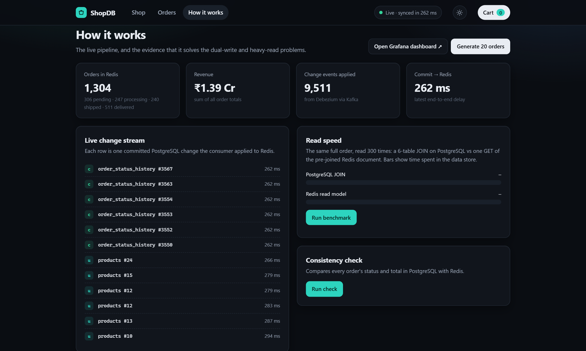
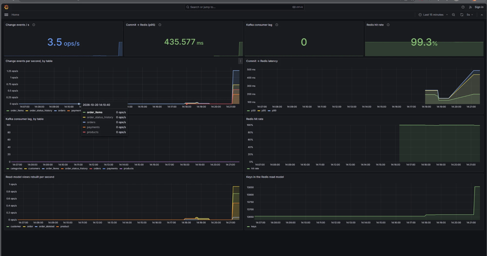

# Real-Time CDC Pipeline for an E-Commerce Database

**PostgreSQL → Debezium → Kafka → Consumer → Redis → Read API**: solving the dual-write problem with
Change Data Capture and read/write separation.

**Course:** 22AIE303 Database Management Systems · Amrita Vishwa Vidyapeetham

| Team member | Roll number |
|---|---|
| Aamith Kishore T J | CB.SC.U4AIE24001 |
| Naveen U | CB.SC.U4AIE24035 |
| Ragav S | CB.SC.U4AIE24041 |
| Padmesh Sivalingam | CB.SC.U4AIE24044 |

**Quick links:** [ER diagram](docs/er-diagram.png) · [UML use case diagram](docs/uml-use-case.png) ·
[DDL scripts](database/) · [Documented SQL queries](database/queries.sql) ·
[Query outputs](database/sample_outputs.txt) · [Screenshots](docs/screenshots/) · [Tests](tests/)

---

## Contents

1. [Project overview](#1-project-overview)
2. [Introduction and problem statement](#2-introduction-and-problem-statement)
3. [System requirements](#3-system-requirements)
4. [Architecture](#4-architecture)
5. [ER diagram and UML diagram](#5-er-diagram-and-uml-diagram)
6. [Relational schema mapping](#6-relational-schema-mapping)
7. [Normalization and functional dependencies](#7-normalization-and-functional-dependencies)
8. [Methodology and database design](#8-methodology-and-database-design)
9. [Advanced SQL queries and their purpose](#9-advanced-sql-queries-and-their-purpose)
10. [Installation, setup and execution](#10-installation-setup-and-execution)
11. [Demonstration and reproducing the database state](#11-demonstration-and-reproducing-the-database-state)
12. [Test cases, validation and results](#12-test-cases-validation-and-results)
13. [Repository structure](#13-repository-structure)
14. onward: implementation details (write path, CDC path, read path, Kubernetes, benchmark, troubleshooting)

---

## 1. Project overview

`shopdb` is the database of an online shop: 7 normalized PostgreSQL tables holding categories,
products, customers, orders, order items, payments and an order-status audit log.

The application writes **only** to PostgreSQL, the source of truth. Debezium reads PostgreSQL's
write-ahead log and publishes every committed row change to Kafka. A consumer turns those events
into **denormalized documents in Redis**, and every customer read is served from Redis by a separate
Read API. A web front end (Shop, Orders, How it works) demonstrates every operation.

| Item | Value |
|---|---|
| Tables | **7** (categories, customers, products, orders, order_items, payments, order_status_history) |
| Seed data | 6 categories · 24 products · 200 customers · 1,200 orders · 2,400 order items · 1,200 payments · 3,360 status-history rows |
| Constraints | 7 primary keys, 6 foreign keys (3 with ON DELETE CASCADE), 3 UNIQUE, 10 CHECK |
| Triggers | 3 (order total, status history, updated_at) |
| Roles | `cdcuser` (owner), `app_writer` (application), `debezium` (CDC, read-only) |

## 2. Introduction and problem statement

An online shop serves far more reads (order tracking, order history, product pages) than writes.
In a normalized database, showing one order requires a **join across six tables**, and those reads
compete with the writes for the same OLTP database. Measured on this project, PostgreSQL read latency
almost doubles when writes run concurrently (1.24 ms → 2.20 ms per order).

The usual remedy is a cache, kept up to date by the application writing to the database **and**
the cache (a *dual write*). If the application fails between the two writes, the cache stays
permanently inconsistent, and nothing repairs it.

**Goal:** a design in which the application writes to exactly one database, reads never load it,
and the fast read copy is guaranteed to converge to the database.

**Objectives**

1. Model the shop with an ER diagram and map it to a relational schema (CO2).
2. Normalize the schema to 3NF/BCNF and justify it with functional dependencies (CO3).
3. Implement constraints, triggers and advanced SQL queries (CO1).
4. Guarantee ACID transactions and concurrency control for order processing (CO4).
5. Use the right high-level databases for each job: PostgreSQL, Kafka and Redis (CO5).
6. Build a backend and frontend that demonstrate every operation.

## 3. System requirements

| Requirement | Version / note |
|---|---|
| OS | Windows 10/11, macOS or Linux |
| Docker Desktop (with Docker Compose) | 4.x or newer, about 6 GB RAM free, to run the whole pipeline |
| PostgreSQL + pgAdmin 4 | optional, 15 or newer, only to load and query the database on its own |
| Python | 3.11+, only to run the tests and the benchmark from the host |
| Browser | any modern browser |

Software used inside the containers: PostgreSQL 15, Debezium 2.6, Confluent Kafka 7.6 (3 brokers +
ZooKeeper), Redis 7, Python 3.11 (Flask, gunicorn, psycopg2, confluent-kafka), nginx 1.27,
Prometheus 2.54 and Grafana 11.2.

## 4. Architecture

```
                        WRITE PATH                                            READ PATH
 ┌───────────┐  SQL   ┌────────────┐  WAL   ┌──────────┐  events  ┌───────┐        ┌──────────┐  GET  ┌─────────┐   ┌──────────┐
 │ Write API │──────► │ PostgreSQL │──────► │ Debezium │────────► │ Kafka │──────► │ Consumer │─────► │  Redis  │◄──│ Read API │◄── customers
 │ (Flask)   │  ACID  │ 7 tables   │logical │ Connect  │ 7 topics │ ×3    │ group  │projector │ views │read model│   │ (Flask)  │
 └───────────┘  txn   └────────────┘decoding└──────────┘   RF 3   └───────┘        └────┬─────┘       └─────────┘   └──────────┘
      ▲                                                                                 │ metrics                        ▲
      │                                                              Prometheus ◄──────┘ ──► Grafana :3000              │
      └─────────────────────────────── nginx website  http://localhost:8080 ───────────────────────────────────────────┘
```

| Layer | Component | Responsibility |
|---|---|---|
| Frontend | `frontend/` (HTML, CSS, JavaScript, served by nginx) | Shop, Orders and How-it-works pages; routes `/api/write` and `/api/read` |
| Backend (write) | `services/write-api/` (Python Flask) | All INSERT/UPDATE/DELETE, one ACID transaction per operation, connection pool, parameterized queries |
| Database | `database/` (PostgreSQL) | Schema, constraints, triggers, seed data, roles |
| CDC | `debezium/`, Kafka | Streams every committed change from the WAL |
| Projector | `consumer/` (Python) | Builds denormalized Redis documents from the change events |
| Backend (read) | `services/read-api/` (Python Flask) | All reads, from Redis only |
| Monitoring | `monitoring/` | Prometheus and the Grafana "CDC Pipeline" dashboard |

## 5. ER diagram and UML diagram

**ER diagram** (crow's-foot notation, entities with attributes, keys and cardinalities):



Relationships: customers **1 : N** orders · orders **1 : N** order_items · products **1 : N** order_items
(so orders **M : N** products, resolved by `order_items`) · categories **1 : N** products ·
orders **1 : N** payments · orders **1 : N** order_status_history.

**UML use case diagram** (actors: Customer, Shop Admin, CDC Pipeline):



## 6. Relational schema mapping

Primary keys are **bold**; foreign keys are marked with →.

| Relation | Attributes | Foreign keys | Constraints |
|---|---|---|---|
| categories | **category_id**, name, description | - | name UNIQUE NOT NULL |
| customers | **customer_id**, name, email, phone, address, city, created_at | - | email UNIQUE + CHECK (format) |
| products | **product_id**, category_id, name, description, price, stock, updated_at | category_id → categories | CHECK price > 0, stock ≥ 0 |
| orders | **order_id**, customer_id, order_date, status, total_amount | customer_id → customers | CHECK status IN (pending, processing, shipped, delivered); total ≥ 0 |
| order_items | **order_item_id**, order_id, product_id, quantity, unit_price | order_id → orders ON DELETE CASCADE; product_id → products | CHECK quantity > 0, unit_price ≥ 0; UNIQUE (order_id, product_id) |
| payments | **payment_id**, order_id, method, amount, status, paid_at | order_id → orders ON DELETE CASCADE | CHECK method IN (card, upi, netbanking, cod); amount ≥ 0; status CHECK |
| order_status_history | **history_id**, order_id, old_status, new_status, changed_at | order_id → orders ON DELETE CASCADE | written only by a trigger |

ER-to-relational mapping: each strong entity becomes a relation with a surrogate `SERIAL` key; each
1 : N relationship becomes a foreign key on the N side; the M : N relationship between orders and
products becomes the relation `order_items`, which also carries the relationship attributes
`quantity` and `unit_price`. Every foreign-key column is `NOT NULL` and money uses `DECIMAL(10,2)`.
The full DDL is in [`database/01_schema.sql`](database/01_schema.sql).

## 7. Normalization and functional dependencies

| Relation | Functional dependencies | Candidate keys | Normal form |
|---|---|---|---|
| categories | category_id → name, description; name → category_id, description | {category_id}, {name} | BCNF |
| customers | customer_id → name, email, phone, address, city, created_at; email → customer_id, … | {customer_id}, {email} | BCNF |
| products | product_id → category_id, name, description, price, stock, updated_at | {product_id} | BCNF |
| orders | order_id → customer_id, order_date, status, total_amount | {order_id} | BCNF |
| order_items | order_item_id → order_id, product_id, quantity, unit_price; (order_id, product_id) → order_item_id, quantity, unit_price | {order_item_id}, {order_id, product_id} | BCNF |
| payments | payment_id → order_id, method, amount, status, paid_at | {payment_id} | BCNF |
| order_status_history | history_id → order_id, old_status, new_status, changed_at | {history_id} | BCNF |

**Justification**

- **1NF:** every attribute is atomic; the repeating group of products in an order is moved to `order_items`.
- **2NF:** no partial dependency; in `order_items`, quantity and unit_price depend on the whole key (order_id, product_id).
- **3NF:** no transitive dependency; customer details (name, email, city) exist only in `customers`, category names only in `categories`.
- **BCNF:** in every non-trivial dependency X → Y, X is a superkey (the alternate keys email and category name are candidate keys).
- `order_items.unit_price` is the price **at purchase time**, a fact about the order line rather than a copy of `products.price`, so it is not a transitive dependency.
- `orders.total_amount` is a derived value kept correct by a trigger inside the same transaction (controlled redundancy, no update anomaly).

**Decomposition from an unnormalized order sheet**

| Step | Relation(s) | Dependency removed |
|---|---|---|
| UNF | OrderSheet(order_id, date, customer_name, email, city, {product, category, qty, price}, pay_method, status) | repeating group |
| 1NF | OrderLine(**order_id, product_id**, date, customer_id, customer_name, email, city, product_name, category, qty, unit_price, pay_method, status) | (one row per item) |
| 2NF | Orders(**order_id**, …), Products(**product_id**, …), OrderItems(**order_id, product_id**, qty, unit_price) | partial: order_id → order data, product_id → product data |
| 3NF/BCNF | customers, categories, products, orders, order_items, payments, order_status_history | transitive: order_id → customer_id → name, email, city; product_id → category_id → category |

Anomalies removed: an email change touches one row (update), a product can exist before it is
ordered (insert), and deleting a product's last order does not lose the product (delete).

## 8. Methodology and database design

1. **Requirements:** a customer browses products, places orders and tracks them; the shop updates
   status, restocks, manages products and customers and views sales reports.
2. **Conceptual design:** ER model with 7 entities and their relationships (section 5).
3. **Logical design:** mapping to relations, keys and constraints (section 6).
4. **Normalization:** functional dependencies and decomposition to BCNF (section 7).
5. **Physical design:** B-tree indexes on every foreign key and on `orders.status`; `DECIMAL(10,2)`
   for money; triggers for derived values and auditing; `REPLICA IDENTITY FULL` and a publication for CDC.
6. **Transactions and concurrency:** every business operation is one transaction. Placing an order
   locks the product rows with `SELECT … FOR UPDATE` in a fixed order (deadlock prevention); locks
   are held until COMMIT (strict two-phase locking); any violation rolls the whole order back.
7. **Security:** least-privilege roles with `GRANT` (`database/03_roles.sql`): `app_writer` cannot
   DROP or ALTER tables, and `debezium` can only read and replicate.
8. **Application:** Flask Write API with a `psycopg2` connection pool and parameterized queries
   (no string concatenation, so no SQL injection); Read API on Redis; HTML/CSS/JS front end.

**Triggers** (`database/01_schema.sql`)

| Trigger | Table | Timing | Purpose |
|---|---|---|---|
| trg_order_items_total | order_items | AFTER INSERT/UPDATE/DELETE | `orders.total_amount = Σ quantity × unit_price` |
| trg_orders_status_history | orders | AFTER INSERT/UPDATE OF status | Audit row for every status change |
| trg_products_touch | products | BEFORE UPDATE | Maintains `products.updated_at` |

## 9. Advanced SQL queries and their purpose

All queries are in [`database/queries.sql`](database/queries.sql), each with a comment explaining its
purpose. Their output on a freshly seeded database is in [`database/sample_outputs.txt`](database/sample_outputs.txt).

| # | Technique | Query | Result (fresh database) |
|---|---|---|---|
| A1–A5 | Catalog queries | Tables, row counts, constraints, foreign keys with delete rules, triggers | 7 tables, 26 constraints, 6 FKs, 3 triggers |
| B1 | INNER JOIN (5 tables) | Lines of order 1 with customer, product and category | Lakshmi Rao: Wireless Earbuds ×1, Water Bottle ×2 |
| B2 | JOIN | Order 1 with its payment and status history | pending → processing → shipped → delivered |
| B3 | LEFT JOIN + aggregates | Products per category with cheapest and most expensive | 6 categories |
| C1 | GROUP BY + SUM/COUNT | Revenue, orders and units per category | Computers first (₹58.3 lakh) |
| C2 | GROUP BY + AVG | Orders and average order value per status | 480 delivered, 240 each other status |
| C3 | HAVING | Payment methods that collected more than ₹33 lakh | cod, netbanking |
| C4 | GROUP BY + ORDER BY + LIMIT | Top 5 cities by revenue | Ahmedabad first |
| D1 | Subquery in HAVING | Customers spending above the average customer | top: Pooja Kumar ₹2.40 lakh |
| D2 | Scalar subquery | Orders above the average order value | 412 orders above ₹11,053 |
| D3 | IN subquery | Customers who bought Electronics | 168 |
| D4 | Correlated NOT EXISTS | Customers with no delivered order | 19 |
| D5 | Correlated subquery | Products priced above their category's average | 8 products |
| E1 | Window function RANK | Best-selling product in each category | Denim Jacket, The Pragmatic Programmer, … |
| E2 | CTE + DENSE_RANK | Top customer in each city | one row per city |
| E3 | Window SUM | Running total of one customer's spending | cumulative per order |
| F1 | VIEW | `order_summary`: one row per order with customer and item count | |
| G1–G2 | Transaction + triggers + ROLLBACK | Place an order, see the trigger-computed total (₹7,498) and history row, roll back | 1,200 orders before and after |

Example (C1):

```sql
SELECT cat.name AS category, COUNT(DISTINCT oi.order_id) AS orders,
       SUM(oi.quantity) AS units, SUM(oi.quantity * oi.unit_price) AS revenue
FROM order_items oi
JOIN products p     ON p.product_id = oi.product_id
JOIN categories cat ON cat.category_id = p.category_id
GROUP BY cat.name
ORDER BY revenue DESC;
```

The application also uses a single 6-table query to build a full order document
(`ORDER_JOIN_SQL` in `services/write-api/app.py`) with `json_agg` sub-queries.

## 10. Installation, setup and execution

### Option A: the database only, in PostgreSQL + pgAdmin

1. Open **pgAdmin 4** → *Servers → PostgreSQL* → right-click **Databases → Create → Database…**, name **`shopdb`**.
2. Right-click **shopdb → Query Tool**. With the 📂 button open and run (F5), **in this order**:
   `database/01_schema.sql` (tables, constraints, indexes, triggers) →
   `database/02_seed.sql` (sample data) → `database/03_roles.sql` (roles).
3. Right-click **shopdb → Refresh**. The 7 tables are under *Schemas → public → Tables*.
4. Open `database/queries.sql` in the Query Tool and run any query (select it, press F5).

The same with `psql`:

```bash
psql -U postgres -c "CREATE DATABASE shopdb"
psql -U postgres -d shopdb -f database/01_schema.sql
psql -U postgres -d shopdb -f database/02_seed.sql
psql -U postgres -d shopdb -f database/03_roles.sql
psql -U postgres -d shopdb -f database/queries.sql
```

A notice that `wal_level` is insufficient for the publication is harmless; it only matters for Debezium.

### Option B: the whole system with Docker

```bash
git clone https://github.com/aamithkishoretj/CDC-pipeline-CC-DBMS-.git
cd CDC-pipeline-CC-DBMS-
docker compose up -d --build
```

Open **http://localhost:8080** (website) and **http://localhost:3000** (Grafana, no login). The
database is created and populated automatically from `database/` on first start, and the Debezium
connector registers itself. PostgreSQL is reachable from the host at `localhost:5433`
(database `shopdb`, user `cdcuser`, password `cdcpass`), for example from pgAdmin.

Configuration is in `docker-compose.yml` (database name, users, ports). Stop with
`docker compose down`; reset to the seed data with `docker compose down -v`.

## 11. Demonstration and reproducing the database state

**Reproduce the database:** run the three scripts in `database/` on an empty database (Option A), or
`docker compose down -v && docker compose up -d --build` (Option B). The seed uses `setseed(0.42)`,
so the data and every count in `database/sample_outputs.txt` are the same on every load (only the
timestamps follow the load date).

**Demonstration (about 5 minutes)**

1. **pgAdmin:** show the 7 tables, their columns and constraints, and run queries from `database/queries.sql`.
2. **Shop** (http://localhost:8080): add two products to the cart and place an order. The page shows
   the journey PostgreSQL → Debezium → Kafka → Redis and the measured delay.
3. **Orders:** *Track this order* (one Redis lookup), then *Mark as processing* (a write to PostgreSQL;
   the trigger writes the history row and the change arrives through CDC).
4. **How it works:** *Generate 20 orders*, *Run benchmark* (6-table JOIN vs one Redis GET),
   *Run check* (PostgreSQL and Redis match), and the dual-write demo (*1. Naive write*, *2. Naive write + crash*).
5. **Constraint violations:** run the commented statements at the end of `database/queries.sql`
   (negative stock, unknown customer, invalid status, duplicate category); PostgreSQL rejects each one.

**Screenshots** ([`docs/screenshots/`](docs/screenshots/))

| Shop | Orders |
|---|---|
|  |  |

| How it works | Grafana |
|---|---|
|  |  |

## 12. Test cases, validation and results

| Test | Command | Result |
|---|---|---|
| 15 end-to-end tests: order creation, stock, status-history trigger, COD settlement, item removal and total recomputation, cascade delete and restock, customer change propagation, oversell rollback, FK/CHECK/status rejections, dual-write failure, Redis = PostgreSQL convergence, latency under 1 s | `python tests/test_e2e.py` | **15/15 passed** |
| Kafka broker failure | `python tests/test_failover.py` | **30/30 orders survived**, zero lost |
| Read benchmark (4 readers, 4,000 reads) | `python benchmark/benchmark.py --reads 4000 --clients 4` | Redis 0.21 ms vs PostgreSQL 2.29 ms (11.1× faster) |
| SQL queries | `database/queries.sql` | outputs in `database/sample_outputs.txt` |

## 13. Repository structure

| Path | Contents |
|---|---|
| `database/` | `01_schema.sql` (DDL), `02_seed.sql` (data), `03_roles.sql` (roles), `queries.sql` (documented queries), `sample_outputs.txt`, Dockerfile |
| `services/write-api/` | Flask Write API (PostgreSQL only) |
| `services/read-api/` | Flask Read API (Redis only) |
| `frontend/` | Website (HTML/CSS/JS) and nginx routing |
| `debezium/` | Connector definition and registration script |
| `consumer/` | Kafka → Redis projector |
| `monitoring/` | Prometheus and Grafana configuration |
| `tests/` | End-to-end and failover tests |
| `benchmark/` | PostgreSQL vs Redis read benchmark |
| `docs/` | ER diagram, UML diagram, screenshots, slides, explanations |
| `k8s/`, `azure/` | Kubernetes manifests and cloud deployment scripts |

---

# Implementation details

## 14. Write path: one ACID transaction per business operation

`POST /api/write/orders` (see `services/write-api/app.py`):

```sql
BEGIN;
  SELECT ... FROM products WHERE product_id = ANY(...) ORDER BY product_id FOR UPDATE;  -- row locks, fixed order → no deadlocks
  -- check stock (409 + ROLLBACK if insufficient)
  INSERT INTO orders (...) VALUES (..., 'pending', 0) RETURNING order_id;               -- trigger: history row
  INSERT INTO order_items (...);                                                       -- trigger: total_amount
  UPDATE products SET stock = stock - :qty WHERE product_id = :pid;                     -- CHECK (stock >= 0)
  INSERT INTO payments (...);
COMMIT;
```

Other write endpoints: change status, remove an item (`DELETE FROM order_items …`, as on the slides),
delete an order (cascades and restocks atomically), create/update customers, update product price/stock.
Constraint violations (CHECK, UNIQUE, FK) are rejected by PostgreSQL and returned as HTTP 400.

The write API **never** writes the Redis read model. (The only Redis code in it is the clearly
separated `/demo/dual-write` endpoint, which writes to a separate `naive:*` key space to show the problem.)

---

## 15. CDC path: Debezium → Kafka → Consumer

- **Debezium** (`debezium/shopdb-connector.json`): `pgoutput` plugin, replication slot `shopdb_slot`,
  `snapshot.mode=initial` (existing rows are streamed first as `op=r`), decimals as strings (exact money).
- **Kafka**: a 3-broker cluster. One topic per table (`shopdb.public.orders`, …), 3 partitions each,
  every partition replicated to all 3 brokers. Messages are keyed by primary key, so all changes to
  one row are **ordered** within one partition.
- **Consumer** (`consumer/consumer.py`), built on `confluent-kafka` (librdkafka):
  - subscribes by pattern `^shopdb\.public\..*`, consumer group `cdc-redis-projector`, and waits
    for Debezium to create the topics on a fresh start;
  - applies a batch of events to a raw replica + indexes, then rebuilds only the affected
    denormalized views (orders, customers, products);
  - **commits Kafka offsets only after Redis is updated** → at-least-once delivery;
  - every Redis write is an absolute SET/HSET/ZADD (no increments) → **idempotent**, so
    re-processing after a crash is harmless;
  - events can arrive in any order across topics (e.g. an item before its order); views are rebuilt
    from whatever has arrived, so they **converge** once all events are in (eventual consistency);
  - exposes Prometheus metrics on `:8000/metrics`: `cdc_events_total`, `cdc_end_to_end_lag_seconds`,
    `cdc_kafka_consumer_lag`, `cdc_redis_keyspace_hits/misses`, `cdc_view_rebuilds_total`.

### Fault tolerance

| Setting | Value | Effect |
|---|---|---|
| Brokers | 3 | the cluster keeps working with one broker down |
| `default.replication.factor` | 3 | every event is stored on all three brokers |
| `min.insync.replicas` + producer `acks` | 2 + `all` | a write counts only once at least 2 brokers have it |
| `unclean.leader.election.enable` | false | an out-of-date replica can never become leader (no silent data loss) |
| Consumer offsets | committed after Redis is updated | at-least-once; replays are idempotent |

`tests/test_failover.py` proves it live: it stops broker 2, keeps placing orders, checks every one
reaches Redis, restarts the broker and waits for full replication. Result: **30/30 orders survived,
zero lost**, fully re-replicated 15 s after the restart. While the broker is down, new changes reach
Redis in 1–16 s (longer when the stopped broker was coordinating the consumer group).

### Monitoring

Prometheus scrapes the consumer every 5 s; Grafana (http://localhost:3000, no login) opens on the
**CDC Pipeline** dashboard: change events per second by table, commit → Redis latency p50/p95/p99,
Kafka consumer lag by table, Redis hit rate, view rebuilds and read-model size. Under simulated load:
p50 ≈ 90 ms, p95 ≈ 210 ms, Redis hit rate ≈ 99%, lag back to 0 within seconds.

### Redis read model

| Key                          | Type   | Contents |
|------------------------------|--------|----------|
| `view:order:<id>`            | string | order + customer + items (product, category, qty, price) + payment + history |
| `view:customer:<id>`         | string | customer + `order_count`, `total_spent`, `last_order_date` |
| `view:product:<id>`          | string | product + category name + live stock |
| `orders:recent`              | zset   | order ids by order date |
| `orders:status:<status>`     | zset   | order ids per status |
| `orders:totals`              | hash   | order id → total (revenue KPI) |
| `customers:all`, `products:all` | zset | listing indexes |
| `raw:<table>:<pk>`           | string | 1:1 replica of each row (used to build views) |
| `idx:*`                      | set    | reverse indexes (customer → orders, order → items, …) |
| `cdc:events`, `cdc:stats`    | list / hash | pipeline telemetry shown on the dashboard |

---

## 16. Read path

`services/read-api/app.py` imports only `redis`. Example: `GET /api/read/orders/42` is a single
`GET view:order:42`. The equivalent Postgres query joins 6 tables
(`GET /api/write/direct/orders/42`, kept only for the benchmark and consistency check).

---

## 17. DBMS concept mapping

| Concept | Where it is in the project |
|---|---|
| Normalization (3NF) | 7-table schema; M:N via `order_items`; no transitive dependencies |
| Integrity constraints | PK, FK + NOT NULL, UNIQUE, CHECK (status, money ≥ 0, stock ≥ 0, email) |
| ACID / transactions | order placement, order deletion with restock, COD settlement on delivery |
| Concurrency control | `SELECT … FOR UPDATE` row locks in a fixed order (deadlock avoidance) |
| Triggers | total recomputation, status audit log, `updated_at` |
| Durability / WAL | Debezium reads the WAL via logical decoding; Kafka persists events; Redis AOF |
| Replication vs denormalization | raw replica + pre-joined views in Redis |
| Eventual consistency | Redis converges to PostgreSQL; consistency checker proves it |
| Indexing | B-tree indexes on all FK columns and `orders.status`; sorted sets in Redis |
| Security / privileges | `GRANT`-based least-privilege roles for the app and for CDC; K8s NetworkPolicies |

---

## 18. Kubernetes

**Easiest: a real cluster (k3s) inside Docker, nothing else to install.** Verified on this project:
12 pods running, 15/15 end-to-end tests passing against the cluster, NetworkPolicies enforced
(read-api → Postgres and frontend → Redis are refused), and the HPA scaled the consumer 2 → 3.

```bash
powershell -ExecutionPolicy Bypass -File k8s/k3s-local.ps1
```

It stops the Compose stack (to free memory), builds the images, starts k3s, copies the images in,
applies the manifests and waits for the pods. Website at http://localhost:30080. Afterwards:

```bash
powershell -ExecutionPolicy Bypass -File k8s/k3s-local.ps1 -Delete
```

**With Docker Desktop Kubernetes or Minikube** instead:

```bash
powershell -ExecutionPolicy Bypass -File k8s/deploy.ps1
kubectl -n cdc get pods -w
```

Website at http://localhost:30080 (Minikube: `minikube -n cdc service frontend --url`). The
Kubernetes manifests use a single Kafka broker to fit a laptop; the 3-broker setup is in Docker Compose.

- `k8s/00-namespace-secrets.yaml`: namespace `cdc`, PostgreSQL credentials as a Secret
- `k8s/10-infrastructure.yaml`: PostgreSQL StatefulSet with a PVC, ZooKeeper, Kafka, Debezium Connect, connector-registration Job, Redis
- `k8s/20-applications.yaml`: consumer (2 replicas), write-api, read-api (2 replicas), frontend NodePort, HPAs for read-api and consumer
- `k8s/30-network-policies.yaml`: only write-api and Debezium may reach PostgreSQL; only consumer/read-api/write-api may reach Redis

Scale the consumer and watch Kafka rebalance partitions between replicas:

```bash
kubectl -n cdc scale deployment consumer --replicas=3
kubectl -n cdc logs -l app=consumer -f
```

---

## 19. Benchmark from the command line

```bash
pip install -r benchmark/requirements.txt
python benchmark/benchmark.py --reads 4000 --clients 4
python benchmark/benchmark.py --reads 4000 --clients 4 --writers 4 --csv under_load.csv
```

No local Python? Run it in a throwaway container on the stack's network:

```bash
docker run --rm --network cdc-pipeline-project_default -v "%cd%/benchmark:/b" python:3.11-slim sh -c "pip install -q -r /b/requirements.txt && python /b/benchmark.py --pg-host postgres --pg-port 5432 --redis-host redis --reads 4000 --clients 4 --writers 4"
```

Measured on the development machine (1,231 orders, 4 reader processes, full order document):

| Scenario | PostgreSQL 6-table JOIN | Redis pre-joined view | Redis advantage |
|---|---|---|---|
| Reads only | 1.24 ms avg · 3,167 reads/s | 0.16 ms avg · 24,224 reads/s | 7.9× lower latency, 7.6× throughput |
| Reads + 4 concurrent writers | 2.20 ms avg · 1,770 reads/s | 0.45 ms avg · 8,550 reads/s | 4.8× lower latency, 4.8× throughput |

Key observation: with concurrent writes, Postgres read latency almost **doubles** (1.24 → 2.20 ms).
That is the heavy-read/write contention from the problem statement, and the reads served from Redis
take that load off the OLTP database entirely.

End-to-end CDC latency (Postgres COMMIT → visible through the Read API): ~100 ms median
(76–193 ms over 10 status updates).

The website's *Read speed* panel shows the time spent in the data store, which the APIs report in a
`Server-Timing` header (about 4× in the browser, where the Flask workers share CPU). It also shows
the full HTTP request time, where both paths carry the same ~15 ms web-server overhead.
The command-line benchmark uses separate reader processes because Python threads would contend on
the GIL inside the benchmark client and hide the difference.

---

## 20. Automated end-to-end tests

```bash
python tests/test_e2e.py
```

Standard library only (no `pip install`). 15 tests write through the Write API and wait for the change
to arrive through the Read API: order creation, stock, status history trigger, COD settlement,
item removal and total recomputation, cascade delete and restock, customer change propagating into
denormalized orders, oversell rollback, FK/CHECK/status rejections, the dual-write failure, full
PostgreSQL vs Redis convergence, and commit → Redis latency under one second.
Last run: **15/15 passed** on Docker Compose and on Kubernetes (k3s).

Broker-failure test (needs the `docker` CLI; stops and restarts `cdc-kafka-2`):

```bash
python tests/test_failover.py
```

---

## 21. Troubleshooting

| Symptom | Fix |
|---|---|
| Page loads but nothing works / red "Can't reach the backend" banner | The Docker stack isn't running. Start it with `docker compose up -d --build`, then use http://localhost:8080 in a normal browser. The page retries automatically and recovers by itself once the stack is up. |
| "Waiting for the first change events…" | Connect takes 30–60 s on first start. `docker logs cdc-connect-init` shows the registration result. |
| `cdc-connect-init` shows *Exited (0)* | Normal: it's a one-shot job. |
| Port 5433/6379/8080 already in use | Stop the other program, or change the left side of the port mapping in `docker-compose.yml`. |
| Changed `database/*.sql` but nothing changed | Init scripts only run on an empty volume: `docker compose down -v` then `up -d --build`. |
| Changed the website, nginx, Prometheus or Grafana config but nothing changed | Config is built into the images: run `docker compose up -d --build`. |
| Grafana shows "No data" | Generate some traffic (website → How it works → Generate 20 orders); panels fill within ~10 s. |
| Want to re-register the connector | `docker compose run --rm connect-init` |
